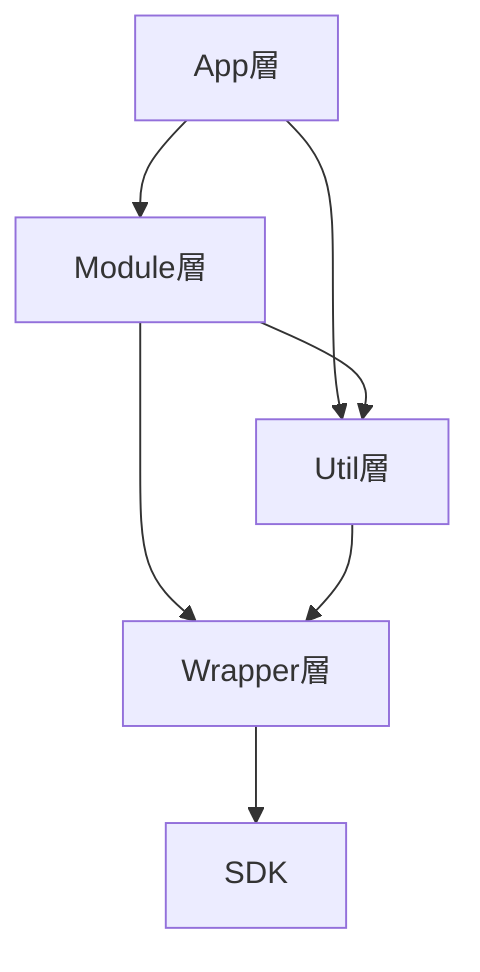
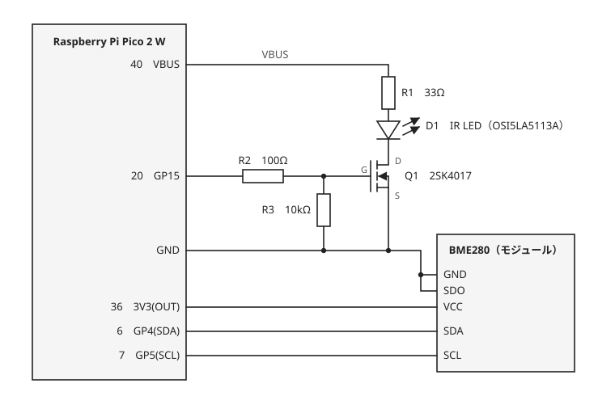
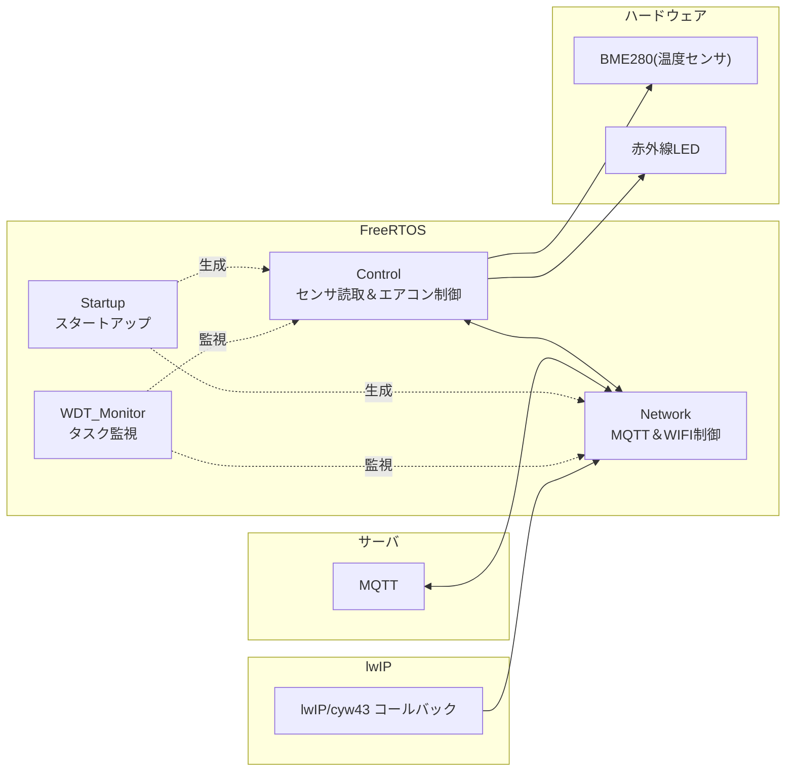
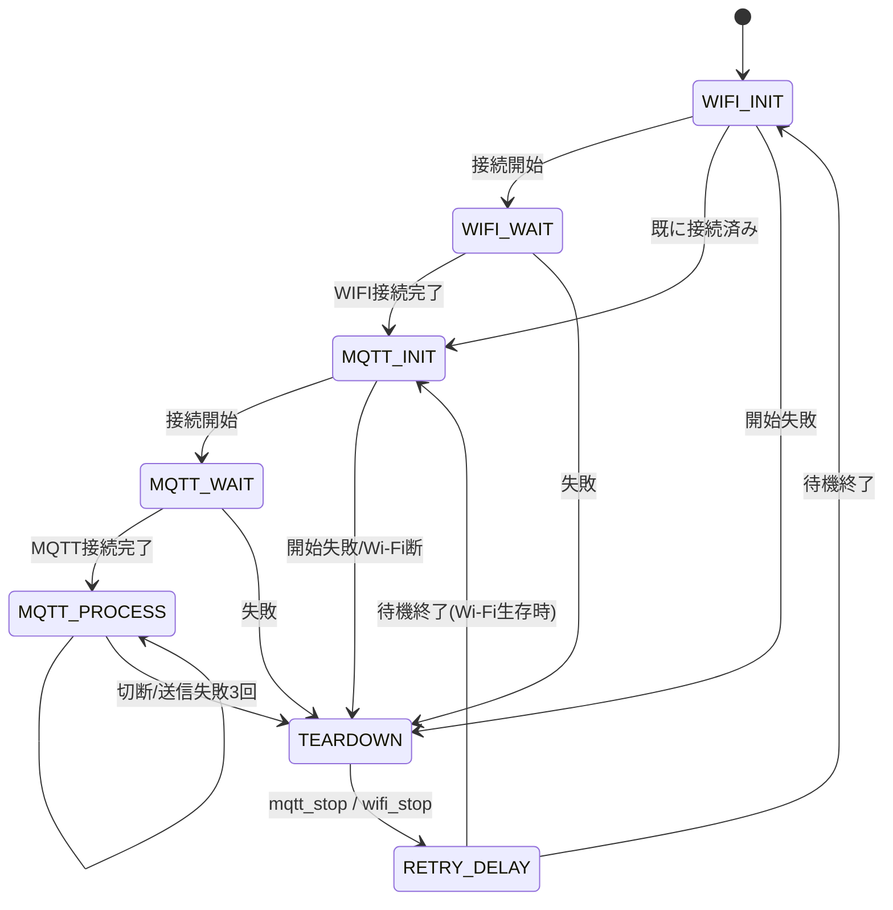
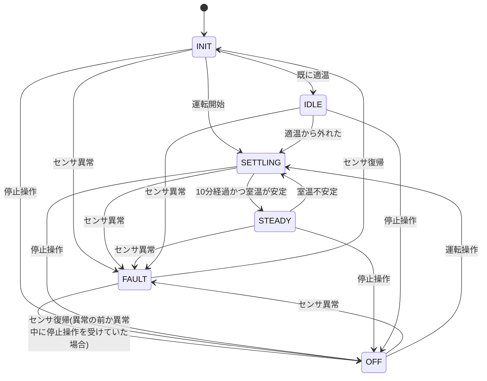

# エアコン自動制御装置

**室温を監視して赤外線でエアコンを自動制御する**システム。  
MQTT経由でPCアプリから遠隔操作・監視も可能。   


## 開発環境

| 項目 | 内容 |
|---|---|
| マイコン | Raspberry Pi Pico 2 W |
| SDK | Pico SDK 2.3.1 |
| RTOS | FreeRTOS-Kernel |
| ネットワーク | lwIP |
| 温度センサ | BME280 |
| 言語 | C |

## ディレクトリ構成

```
src/
├── main.c              エントリポイント
├── apps/               アプリ層
│   ├── network/        Wi-FiとMQTT関連
│   ├── control/        エアコン制御関連
│   └── wdt_monitor.c   ウォッチドッグ
├── modules/            モジュール層
├── utils/              Util層
└── wrappers/           ラッパー層
```

## レイヤ構成図



## ハードウェア構成



## タスク構成図



## 状態遷移図(ネットワークタスク)


**補足**
- すべての異常系をTEARDOWNへ通し、開始終了は常に対にする。
- リトライ時間は指数バックオフ（上限60秒）。
   
## 状態遷移図(制御タスク)


**補足**
- IDLEは起動時に既に適温だったときの待機で、室温が外れれば自動で運転を始める。
- OFFはPCからの停止操作による停止で、次の運転操作を受けるまで自動では運転しない。
- FAULT以外の状態で運転操作を受けるとSETTLINGに移る。
- FAULTの間は運転操作は受け付けない。
- OFFは再起動すると解除され、INITから始まる。
